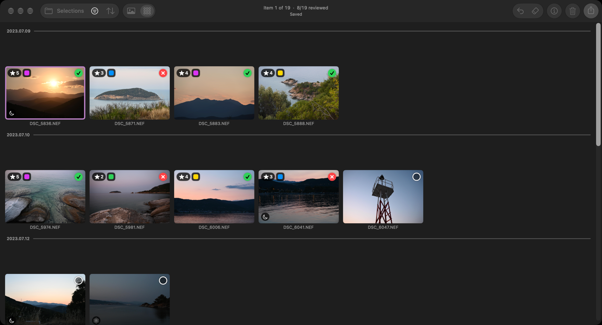

# Louppe user guide

[Install Louppe](../README.md#install) · [Documentation](README.md)

Use **Help → Louppe Help** for a quick reference and searchable shortcuts
that reflect your saved keys. This guide covers the full workflow in the
current source; installed releases may differ. Check the
[version history](../CHANGELOG.md) for changes.

- [Quick start](#quick-start)
- [Apple Photos](#apple-photos)
- [Review and file handling](#review-and-file-handling)
- [Media and inspection](#media-and-inspection)
- [Keyboard shortcuts](#keyboard-shortcuts)
- [Interface languages](#interface-languages)

## Quick start

1. Open a folder or memory card.
2. Review media in Gallery or Grid; switch from the toolbar or the View menu.
3. Press **F** for Yes or **D** for No.
4. Filter, sort, select, clean up, organize, or export.

In Finder, select a media folder and choose **Services → Open in Louppe**.
Install Louppe in Applications first to register the service. It opens the
folder in the existing window.

You can also drop one folder onto the Dock icon or anywhere in the main window,
including while reviewing another folder. Louppe saves current decisions before
switching and keeps your chosen review-window size.

On Welcome, choose **Pin Folder…** to keep a folder shortcut without opening it.
Pinned folders remember the current photo and browsing position. Disconnected
folders stay visible; their menu offers Locate and Unpin. While Welcome is open,
Louppe quietly reads a pinned folder when its drive connects, so it opens faster.
Previously opened pins can show cached photos immediately, with the toolbar's
loading indicator while Louppe checks the folder. Photos added or removed since
the last visit appear correctly when checking finishes; decisions and file
actions become available then. Pinning does not copy your originals.

Large folders open in the normal review window as soon as their files are
listed. Browse in Gallery or Grid and show Browser or Info while the toolbar
counts loaded photo details. Decisions, sorting, filters and file actions stay
greyed out until loading finishes. Esc clears the selection, then cancels.

*Grid for comparing and selecting frames.*

When Grid is sorted by date, dragging the scroll bar's knob shows the month and year
of the photos you're passing, or “Unknown date” for items without a capture date.

The toolbar shows the item position, Yes and No totals (No appears once
something is marked No) and save status. Unmarked is a normal state, not
unfinished work. Clicking the status shows review tips while they are enabled. The floating photo control provides Fit and 30–400% zoom.
Double-click anywhere on the zoom control to Fit.
Pinch to zoom; pan with two-finger scrolling or dragging.
**S** returns custom zoom to centered 100%, then toggles Fit; **A** toggles
Phone size. **Help → Louppe Help** has searchable shortcuts. Restore dismissed
tips with **Settings → General → Show quick-start tips while reviewing**.

Yes/No, stars, and color labels are independent. **No never trashes files.**
**Mark Yes** (**F**) and **Mark No** (**D**) on an item already marked that
way: press again to make it Unmarked; that never moves on. With several items
selected, they become Unmarked only when all have that decision; otherwise all
are marked (a Mixed RAW+JPEG pair is marked). A new mark moves to the item after
the marked ones and stops at the last one; holding a key never repeats it. Ratings save automatically; reopen the folder
to continue.

Export starts with **All selected** when you select items, otherwise with
filtered **Keepers (Yes)**. **4–5 stars** includes either decision. Check the
matching count before choosing a destination. Export copies by default;
Move transfers originals and cannot be undone; Metadata (XMP) writes ratings
to sidecars for other apps. **Clean Up** sends files to macOS Trash.
**Organize Source Folder** builds folders from decisions, dates, ratings,
and other metadata.

## Archive folders

When the opened folder has subfolders, two buttons at the top of the leading
pane switch it between **Browser** and **Folders** in one click. In Grid, the
sidebar toolbar button opens Folders; choosing Browser there returns to
Gallery. Info stays on the right. Folders with no subfolders keep the original
Browser/Grid layout without folder controls. Louppe remembers whether you last
used Browser or Folders.

Select a folder to browse it without rescanning or opening another session.
A click hands the keyboard back to the media, so arrows keep moving through
items. With keyboard navigation turned on, Tab moves focus into the tree, where
arrows move between folders. The button at the pane's top right expands or
collapses every folder (Option-click a disclosure triangle for one branch).
Collapse All keeps the current folder visible and never changes the folder
you are reviewing. Drag the pane's edge to fit long names; double-click the
edge to restore the standard width.

Counts include subfolders and count a RAW+JPEG pair once when pairing is
enabled. Empty folders remain visible but
dimmed. **All Media** shows the entire archive. When the tree is hidden or
showing Browser, a breadcrumb inside a subfolder lets you return to an
ancestor. It stays hidden at All Media and while the folder tree is visible.
A folder's context menu or breadcrumb menu can turn off **Include Subfolders**
for direct items only; the context menu also offers **Show in Finder**.
Metadata filters apply inside the chosen folder. Folder counts describe the
inventory before those filters, so a nonempty folder can have no filter matches.

Louppe remembers each folder's current item and independent Browser/Grid position,
plus the expanded folders. Missing or replaced directories fall back to a verified
ancestor. Originals, decisions and the archive's single save location stay intact.
Opening a folder also includes decisions saved by earlier sessions of its
subfolders, and of a parent folder you pinned or opened recently; for each
file the most recent decision, stars and color win. Only the opened folder's
session file is written; one line reports what was included.
If saved browsing positions cannot be read, **Reset Folder Navigation** starts
fresh browsing memory and preserves the old memory files beside it. Decisions
and originals are unaffected.

Export, Clean Up, Rename, Organize, Clear All Decisions and Clear Stars and
Labels follow the current folder scope. Their All choice reads **Current Folder**, or **Entire Archive**
at All Media. Filtered and Selected narrow it further. Paired RAW+JPEG files stay
together even when a partner is outside the chosen folder; check the preview and
confirmation before file work. Yes/No totals and Clear availability follow
the folder before metadata filters. Navigate to All Media explicitly for archive-wide work.

## Apple Photos

Choose **File → Open Apple Photos…** and grant Photos access. Select your
library or an album, optionally narrow the dates manually or with **Recent Dates →
Last Week / Last 7 Days**, and open the complete selection in Gallery or Grid.
There is no batch size or page to choose. The chooser remembers the source,
dates and order; reopening refreshes library membership.

The selection opens without downloading every original. Review images load as
you browse. In **Settings → General → iCloud Access**, enable **Allow iCloud
Review Images** when a needed image is not on the Mac. Photos may download
source data to make that image; Louppe cannot guarantee thumbnail-only network transfers. Cached local representations can
work offline. Cloud/unavailable items have Retry; Gallery shows preview pixel
dimensions and never treats a preview as 100% original detail.

**Open Original Detail**, original video playback and Copy request primary
original files separately. **Allow iCloud Originals** is a separate choice in
Settings. Both choices are remembered across launches.
Requests show progress and can be canceled. Original staging remains limited
to 5 GB, including any open original detail. Copy downloads, validates and
copies one exact original at a time, then releases its temporary file. Total
export size is unknown until originals load; space is checked for each file.
Temporary files retire when released or when switching/closing the review.

Choose a different Photos selection from **Filter → Choose Photos…**.
Yes/No, stars, and colors save locally by Photos asset ID across overlapping
selections. **File → Add to Album…** adds current, selected, filtered, or all
reviewed items to an existing album, or a new album inside a Photos folder.
Confirm the exact scope and destination first. Existing memberships and originals
stay intact; local ratings do not change Favorites. Cancel stops remaining
additions; completed additions stay. Album additions have no Louppe Undo.
One-destination Copy is
available; Photos routing Copy, file Rename/Move/Organize, XMP and Trash are
unavailable. EXIF, original byte sizes and original
quality/exact/similarity checks are unavailable during preview review. Capture
groups use known Photos dates without downloading originals.

This uses the System Photo Library. Review previews are unadjusted, excluding
Photos edits; original detail and Copy use the primary original resource.
Live Photos use their still image; RAW+JPEG assets remain one primary-original
review item. Hidden items are excluded. Libraries on unmounted drives and
unavailable originals must be made accessible in Photos first.

## Review and file handling

- Filter and sort by decisions, stars, colors, dates, folders, camera details,
  file types, and media properties. **Filter → Date taken** narrows by range,
  year, or individual dates; each choice is kept when you switch between them.
- Fuji film simulation appears in Info and **Filter → Film simulation**. Include
  any combination of the recorded simulations, including monochrome and ACROS
  variants; hidden photos keep their decisions. **All** restores that facet.
- **Sort → Folder hierarchy** shows root files, then each folder before its
  descendants. Reversing changes sibling order; headers show relative paths.
- **Sort → Review groups → Analyze Folder Locally** finds exact duplicates,
  likely similar photos, and bursts. Analysis stays on your Mac and never
  changes ratings or files automatically. **View → Review Groups** offers the
  same groups; **Return to Normal Review** exits them.
- **Filter** can group matching RAW+JPEG files as one item while retaining
  separate decisions, stars, and colors. Without a same-named JPEG, a RAW pairs
  with its HEIC/HEIF, then JPEG XL file in the same folder.
- **Edit → Clear All Decisions…** (**R**) makes the folder's items Unmarked
  and keeps stars and labels. **Edit → Clear Stars and Labels…** removes stars
  and color labels and keeps decisions. Both ask first above 15 items and undo
  in one step with **⌘Z**.
- **Clean Up** offers **Trash No…** and **Trash No + Unmarked…**; the
  confirmation counts No and Unmarked items separately, and Mixed RAW+JPEG
  decisions stay. It supports All Media, Filtered, and Selected scopes, plus
  RAW-only or JPEG-only Trash for unambiguous RAW+JPEG pairs. **⌘Z** restores the batch
  before closing the session, while files remain in Trash. **⌘⌫** trashes the
  selection without a dialog; marking **No** never trashes anything.
- **Organize Source Folder** previews nested folders before moving files.
  **Rename Files…** supports single names and metadata-based batches. Drag
  filename parts into order; dates follow the Mac’s preferred format with safe
  filename separators. Extensions stay unchanged and recognized RAW+JPEG/XMP
  families follow. **⌘Z** restores renamed files and organized locations during
  the open session. Without **Sequence**, files that would share a name get a
  number per shared name, oldest first (`2026.02.20_001`), skipping names
  already in the folder. Name collisions never overwrite another file.
- Export Copy and Move support All Media, Filtered, and Selected scopes.
  **Route copies to multiple folders** previews decision, stars, color,
  file-type, or media-type rules before copying.
- Drag photos, videos or other files from Grid, Browser or a Gallery photo at
  Fit or Phone size into Finder or another app to **copy** their originals;
  RAW+JPEG pairs bring both files. Dragging a selected item drags the whole
  selection; dragging any other item drags only that one. Louppe offers only
  Copy: Finder copies even on the same drive, and the Trash refuses the drop.
  In Grid, drag the photo itself; dragging from empty space or a filename still
  selects a range. A zoomed Gallery photo pans instead. Missing originals, and
  files replaced since Louppe scanned them, are left out (Open With too). Apple Photos items can't be dragged; use Export → Copy.
- **File → Open With** (also in the Grid, Browser and Gallery context menus and
  the Command Palette) opens the same originals in place in Lightroom Classic,
  Capture One, Photoshop or Preview, whichever are installed, or in each file's
  **Default App**. Louppe only hands the files over; what the app does next,
  such as importing them into a catalog, is up to that app. Opening more than
  50 files at once asks first; a RAW+JPEG pair counts as two files.

**Settings → General** holds review defaults, RAW display, quality cues,
iCloud access, getting-started tips, updates, and optional support.
**Settings → Keyboard shortcuts** holds key assignments. Review and
New folders set defaults for advancement,
Gallery/Grid, sort, and dividers in new folders. Rescan keeps the current
layout. Connected drives and cards appear on the start screen with capacity
and a folder chooser.

Ratings save to `.louppe_session.json` in the opened folder. An identity-bound
local backup can protect the session when that folder or card is unavailable.
Changed-file decisions remain in recovery history while you keep reviewing.
**File → Check Saved Decisions…** offers restoration; verified identical copies
and returning originals recover automatically. Older sessions need confirmation.
Sessions saved by 1.11 use a newer format that 1.10 cannot read.

## Media and inspection

Zoom with the slider or pinch; pan with two-finger scrolling or dragging.
Double-click a point in a photo to inspect it at 100%. Use the photo size
controls to return to Fit, 100%, or Phone size.

Louppe supports common camera RAW, JPEG, TIFF, PNG, HEIC, JPEG XL (.jxl),
WebP, AVIF, video, audio, and text formats. Unsupported files remain available to rate and export.
Opening a folder skips hidden items, packages such as Photos libraries, Capture
One's own `CaptureOne` cache folders (those holding only `Cache` and `Settings`
folders) and Lightroom `.lrdata` preview folders. Capture One session folders
such as Capture, Selects and Output are scanned normally.
Gallery has Fit, Phone size, true 100% zoom, playback, metadata, histogram,
clipping information, and optional quality cues. VoiceOver and keyboard review
are supported.

For supported video, **Info → Subtitles** offers caption controls and available
subtitle tracks. Current macOS also supplies native caption-style options.
**Audio track** appears when a file has alternative audio; **Automatic** follows
system preferences, including described audio when provided by the file.
Manual choices stay with the current item when switching Gallery/Grid.

For RAW photos, **Fast** uses previews below 100% and Apple RAW rendering at
100% and above. **Settings → General → RAW display** can use RAW at all zoom levels.
The Gallery zoom bar stays focused on Fit and magnification; **Use Preview**
remains an explicit fallback after a RAW loading failure.
Apple rendering may differ from your editor or the camera JPEG.

RAW display settings offer **Apple Default** or opt-in **RAW 9**.
RAW 9 requires macOS 27, a supported file, and Apple’s model resources; it
uses more time and memory. Failure offers Retry or **Use Apple Default**;
Louppe never silently switches decoders. Grid and Browser retain fast previews.

For RAW files, the histogram switches from **Preview** to **RAW** after a scaled
linear analysis, independent of photo rendering. Other photo formats have no
source tag. The **X** overlay measures the displayed rendering.

**Focus peaking** (**P**, or **View → Focus Peaking**) outlines crisp, in-focus
edges in light purple, so you can see where focus landed without zooming. It
measures the displayed photo, works at Fit and 100%, and draws over the clipping
overlay when both are on. Edges count as sharp by their width, not their
contrast: a soft photo shows few or no outlines, and smooth areas and grain stay
clear. Fit measures the downsized preview, which looks sharper than 100%; check
critical focus at 100%.

**Filter → Quality cues** finds High ISO, Slow shutter, Near-white and Near-black
areas. Set their switches and thresholds in **Settings → General → Quality Cues**; cues
appear inside Browser/Grid tiles and above the Info histogram. Checks prioritize
photos you view and pace the remaining folder in the background. Use **Pause checks**
and **Resume checks** in Filter; Pause stays in effect until you resume. Cues never
set decisions.
**Filter → Capture bursts** groups consecutive photo times within the chosen gap;
set the interval in **Settings → General → Capture bursts**. It can merge separate shutter
presses or cameras. Inferred dates are labeled.

When a photo has valid GPS coordinates, **Info** shows them with an **Open in
Maps** button (not for a fix the camera marked void, or 0,0). Louppe looks nothing up and sends nothing until you click it; Maps then
shows that point.

Text previews are read-only and selectable. TXT, TEXT, MD/MARKDOWN, XML,
JSON, CSV, TSV, LOG, YAML, and YML appear alongside media. Markdown supports
headings, lists, bold, italic, and web/email links; other formats show source
text. UTF-8 and BOM-marked UTF-16/32 are supported up to 1 MiB per file.
Enlarge document text to 200% with **Settings → General → Accessibility → Text preview size**.

## Keyboard shortcuts

Shortcuts work while reviewing media. Text fields, dialogs, and native macOS
controls keep their normal shortcuts.

In **Settings → Keyboard shortcuts**, choose **Follow keyboard layout** or
**Physical key positions**. Physical positions keep the same finger movements
when switching layouts, including Dvorak; position names refer to QWERTY keys.
New setups start with physical positions; saved choices are retained.
Choose a key on the keyboard map to see its actions, or search the grouped editor.
Choosing a key only filters the editor. If the key is free, **Assign…** adds it
to an action you pick, with that action's usual view and media context. Pointing
at a shortcut in the editor lights its key on the map. Use **Add shortcut** to
record another key, click an existing binding to replace it, or use its remove button.
Letters, numbers, punctuation, arrows, Tab and Space can be assigned. Each
matching mode keeps its own bindings.

Click Command or Shift on the keyboard to preview modified shortcuts; holding
the keys previews them temporarily, and choosing a key while holding them keeps
that layer on. Command shortcuts follow the current Mac
keyboard layout independently of physical review positions. Export, Command
Palette, Rescan and Enclosing Folder accept several Command or Shift-Command
letter or arrow shortcuts.
Their aliases appear with the corresponding actions in the same editor.
Standard Mac and modified navigation shortcuts remain read-only.

**When** limits a key to a view or media type. A key can serve different actions
only when their contexts do not overlap: Left Arrow navigates outside Gallery
video and seeks within a playable Gallery video. Conflicts name the existing
action and overlapping context. Reset an action with its reset button, or use
**Restore shortcut defaults** to reset the current review mode and Command
shortcuts together. Menus, the Command Palette, Help and tooltips reflect the
saved keys and contexts. Escape retains its native selection/cancel behavior.

Use View or the Command Palette to choose Browser or Folders, show or hide the
sidebar, and expand or collapse folders. Previous/Next Folder skips empty and
container-only folders; Next from All Media goes to the first folder with direct
media. Next Folder with Unmarked Items goes to the next folder whose own items
(not its subfolders') include an Unmarked item or a Mixed pair.
Entering a folder keeps the current item when it belongs there; otherwise it
starts at the first Unmarked (or Mixed) item. Enclosing Folder returns to the parent,
including container-only folders.
Show Current Item’s Folder keeps that item current. Go to All Media restores the
whole archive. The palette also lists folder paths for archives of up to 2,000 folders.
Folder commands require an archive hierarchy. They wait during file operations;
Q and T remain available to switch sidebar content.

The table below lists the defaults. **Help → Louppe Help** shows your current
assignments and their view/media contexts, including customized keys.

| Shortcut | Action |
|---|---|
| **F** | Mark Yes; advance if enabled in Review settings. Press again to make it Unmarked |
| **D** | Mark No; advance if enabled in Review settings. Press again to make it Unmarked |
| **0–5** | Clear or assign a 1–5 star rating |
| **← / →** | Previous / next item; in Gallery video, seek 0.5 seconds |
| **↑ / ↓** | Previous / next item in Gallery; previous / next row in Grid |
| **J / L** | Previous / next item |
| **Space / K** | Play or pause video/audio; Space advances on photos |
| **Shift + ← / →** | Seek 5 seconds in Gallery video |
| **S** | Toggle true 100% zoom in Gallery |
| **A** | Toggle phone-sized preview in Gallery |
| **X** | Show or hide the clipping overlay in Gallery |
| **P** | Show or hide focus peaking in Gallery |
| **Tab / G** | Switch between Gallery and Grid |
| **Q** | Show or hide the Gallery thumbnail browser; switch from Folders to Browser |
| **T** | Show or hide Folders in Gallery or Grid |
| **[ / ]** | Previous / next folder with direct media, in outline order |
| **⌘↑** | Enclosing folder; top-level folders return to All Media |
| **W** | Show or hide the Info panel |
| **⌘+ / ⌘−** | Make Grid thumbnails larger / smaller |
| **E / ⌘E** | Open Export |
| **R** | Clear All Decisions in the current folder (asks first above 15) |
| **Z / ⌘Z** | Undo the latest review or file action |
| **⌘O** | Open another folder |
| **⌘R** | Rescan the current folder |
| **⌘F** | Open Filter and focus Search |
| **⌘K** | Open the Command Palette |
| **⌘A** | Select all visible items |
| **⌘← / ⌘→** | Slower / faster playback; previous / next item for other media |
| **⌘⇧← / ⌘⇧→** | Select from the current item to the first / last |
| **⌘,** | Open Settings |
| **⌘W / ⌘Q** | Close the window / quit Louppe |
| **Esc** | Cancel a scan or clear the current selection |
| **⌘⌫** | Trash selected items without a dialog |

When macOS Keyboard Navigation is on, Tab and Shift-Tab move focus between
controls. Use **G** to switch views.

## Interface languages

Louppe follows macOS language preferences and per-app language settings, with
English fallback. Spanish, Simplified Chinese, Hindi, Portuguese, and Arabic
are bundled; Arabic uses right-to-left layout. Restart Louppe after changing
its language. Keyboard shortcuts, filenames, and portable XMP values stay the same.
